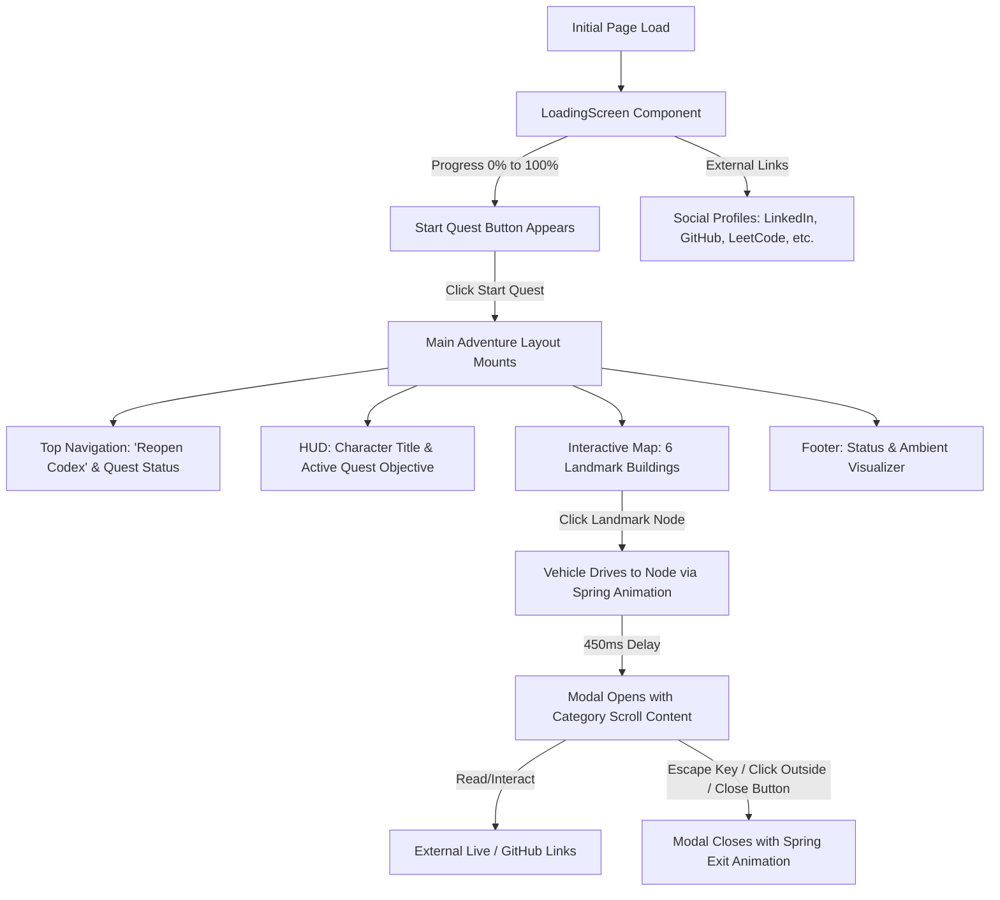

# 🗺️ System Architecture & Engineering Blueprint: Shubham Rawat RPG Portfolio

> **Target Audience:** AI Assistant / AI Systems Architect  
> **Document Purpose:** Complete technical and architectural briefing of this repository. This document provides total structural, aesthetic, and functional clarity without requiring raw access to the entire codebase. Use this context to brainstorm, debate, refine, and generate targeted feature/refactoring prompts.

---

## 1. Executive Summary & Core Concept

This project is a **commercial-grade, highly interactive RPG/Adventure Game Map Portfolio** for **Shubham Rawat**, a Full Stack Software Developer.

### The Paradigm Shift
Instead of conventional scrolling resumes or standard developer landing pages, this application presents an **illustrated fantasy world / treasure map**:
- The visitor acts as an **Adventurer/Recruiter** navigating a fantasy realm.
- Professional experience, projects, skills, education, achievements, and contact portals are modeled as **Cities, Guilds, Castles, Academies, and Docks**.
- Technical proficiencies and metrics are translated into **RPG mechanics** (Quest Tiers, Mana Costs, Cooldown Seconds, Intelligence Boosts, Passive Special Abilities, Prestige Multipliers, and Loot drops).
- Navigation is physical and spatial: Clicking an objective drives an animated **Hero Vehicle (Adventurer Car)** across winding dirt roads and river bridges before opening parchment/glassmorphic codex scrolls.

---

## 2. Technology Stack & Dependencies

| Layer | Technology | Details / Rationale |
| :--- | :--- | :--- |
| **Framework** | **React 19** (`react@^19.0.1`, `react-dom@^19.0.1`) | Modern functional components, React hooks. |
| **Language** | **TypeScript 5.8** | Strict typing across all data structures and UI interfaces. |
| **Build Tool** | **Vite 6** (`vite@^6.2.3`, `@vitejs/plugin-react@^5.0.4`) | Fast HMR and lightweight production bundling. |
| **Styling** | **Tailwind CSS v4** (`tailwindcss@^4.1.14`, `@tailwindcss/vite`) | Utilizes `@theme` directives, keyframe animations, zero legacy config files. |
| **Animations** | **Motion** (`motion@^12.23.24`, via `motion/react`) | Spring-based vehicle motion, entrance/exit modals (`AnimatePresence`), floating elements. |
| **Icons** | **Lucide React** (`lucide-react@^0.546.0`) | Consistent icon system for controls, tech badges, and modal category headers. |
| **AI Integration** | **Google GenAI SDK** (`@google/genai@^2.4.0`) | Pre-installed for server-side / client-side Gemini model workflows. |
| **Fonts** | Google Fonts | `Space Grotesk` (headings/display), `Inter` (UI/body), `JetBrains Mono` (stats/metrics). |

---

## 3. Directory Structure & File Taxonomy

```text
shubham-rawat-rpg-portfolio/
├── index.html                   # HTML mount point, viewport & font configurations
├── metadata.json                # AI Studio manifest & capabilities definition
├── package.json                 # Dependency manifests and npm execution scripts
├── tsconfig.json                # TypeScript compiler configuration (ESNext, Bundler resolution)
├── vite.config.ts               # Vite configuration with Tailwind v4 and React plugins
├── public/                      # SEO & crawl assets (robots.txt, sitemap.xml)
└── src/
    ├── main.tsx                 # React DOM root hydration
    ├── index.css                # Global CSS, Tailwind @theme animations & RPG textures
    ├── App.tsx                  # Core state coordinator, routing, modal orchestration
    ├── components/
    │   ├── LoadingScreen.tsx    # Immersive startup screen with progress bar & social links
    │   ├── HUD.tsx              # Top wood-panel banner, player info, and active quest objective
    │   ├── Map.tsx              # Interactive SVG parchment map, landmarks, roads, & hero car
    │   ├── Modal.tsx            # Accessible glassmorphic popup dialog with spring animations
    │   ├── CardRenderer.tsx     # Specialized thematic card renderers for each data category
    │   └── Footer.tsx           # Status bar and simulated chiptune audio visualizer
    └── data/
        ├── experience.ts        # Work history modeled as S/A/B-Tier quests with XP & Loot
        ├── projects.ts          # 11 engineering projects modeled as Legendary/Epic/Rare relics
        ├── skills.ts            # Languages, frameworks, tools, and cloud masteries (1-5 stars)
        ├── education.ts         # Academic institutions modeled as Arch-Academy scrolls
        ├── achievements.ts      # Open-source contributions & bug triumphs with Prestige points
        ├── certificate.ts       # Industrial credentials & professional seals
        └── contact.ts           # Communication channels modeled as Harbor Message Portals
```

---

## 4. Key Architectural Patterns & Contracts

### 1. Complete Decoupling of Data and Presentation
- **All content is strictly data-driven:** The UI components in `src/components/` contain **zero hardcoded resume content**.
- Content is fully contained in typed arrays within `src/data/*.ts`.
- Modifying, adding, or deleting an experience, project, or skill only requires altering the relevant data file. The UI dynamically derives levels, cards, and modal lengths without manual template adjustments.

### 2. The Universal Link Sub-Component (`CardLinks`)
- Located in `src/components/CardRenderer.tsx`.
- Standardizes action links across every card type:
  - **Left slot:** Live project link or certificate verification (`🌐 Live Link` / `🌐 Play Game` / `🌐 Verify Certificate`).
  - **Right slot:** Source code or proof link (`⚔️ Forge Link (Github)` / `⚔️ The Fix` / `⚔️ PR Code Contribution`).
- Supports disabled/read-only states if a link is not supplied.

### 3. Spatial Game Map Geometry & Coordinate System
- Built inside `src/components/Map.tsx`.
- Uses a **percentage-based 100x100 virtual coordinate grid** over a responsive `aspect-[16/10]` container.
- Connecting pathways (roads, rivers, dashed footsteps) are drawn with SVG bezier curves (`M x,y C cx1,cy1 cx2,cy2 x2,y2`).
- The **Hero Vehicle (Car)** tracks the coordinates of the selected location (`activeLoc.x`, `activeLoc.y + 5%`) using Framer Motion's spring physics (`stiffness: 120, damping: 20`).

---

## 5. Component Deep Dive & User Journey

### Flow Lifecycle


### Component Breakdown

#### 1. `LoadingScreen.tsx`
- **Purpose:** Sets the fantasy gaming tone while assets sync.
- **Features:**
  - Cycling witty developer loading steps (*"Summoning full-stack server nodes...", "Preparing O(1) LRU Cache spellbook...", "Calibrating AI Roast motivator witty response matrices..."*).
  - Progress bar incrementing from 0% to 100%.
  - On completion, reveals a wooden **"Start Quest"** button.
  - Quick-access social buttons: LinkedIn, GitHub, X (Twitter), Email, LeetCode, GeeksforGeeks.

#### 2. `HUD.tsx`
- **Purpose:** Fantasy-style heads-up display.
- **Elements:**
  - **Wood-carved Nameplate Banner:** Shubham Rawat, "Full Stack Developer", tagline, and decorative leaves/hanging ropes.
  - **Active Quest Panel:** An objective scroll briefing the player to explore destinations across the map.

#### 3. `Map.tsx`
- **Purpose:** The core interactive visual centerpiece.
- **Visual Layers:**
  1. **Weather Layer:** Continuous CSS-animated drifting clouds with staggered speeds.
  2. **Topography (SVG):**
     - Sparkling winding river with animated dashed current lines.
     - Wooden bridge with plank and railing details over the river.
     - Sandy dirt roads with glow filters connecting the nodes.
     - Decorative campfire with animated flickering flame and rising ember particles.
     - Directional signposts, swaying procedural pine trees, and a harbor sailboat.
  3. **Landmark Buildings (Nodes):**
     - Each node has custom SVGs with micro-animations:
       - **Experience City:** Workshop with rising smoke particles and facade gears.
       - **Projects Village:** Windmill with continuously rotating 360° blades.
       - **Guild of Skills:** Magical spire with a floating glowing mana orb.
       - **Academy:** Architectural university clocktower with clock hands and archways.
       - **Achievement Castle:** Fortress towers with a floating golden star.
       - **Credentials Dock:** Maritime dock with a pulsating golden lighthouse seal.
  4. **The Hero Vehicle:** A custom SVG traveler carriage with rotating wheels, bobbing suspension, exhaust smoke emissions, and a "Hero" marker that drives to the clicked node.

#### 4. `Modal.tsx`
- **Purpose:** Reusable, accessible game codex dialog.
- **Capabilities:**
  - Category-specific glowing border colors and header icons (e.g. Backpack for Experience, Sparkles for Projects, Trophy for Achievements, Star for Education).
  - Keyboard accessibility (ESC key to dismiss), backdrop click dismissal, and locked body scroll while active.
  - Responsive layout with custom hidden scrollbars (`no-scrollbar`).

#### 5. `CardRenderer.tsx`
- Contains specialized card designs tailored to each data schema:
  - `ExperienceCard`: Displays Quest Tier (S/A/B), bullet objectives, tech badges, XP/Gold/Loot rewards.
  - `ProjectCard`: Displays Relic Complexity (Legendary/Epic/Rare), Mana Cost, Cooldown, Passive Special Ability, tech stack, and forge links.
  - `EducationCard`: Displays CGPA, Intelligence Boost meter (`+45 INT`), wisdom quote, and core coursework spells.
  - `AchievementCard`: Displays rarity badges, dates, title bestowed, and prestige points (`+500 PRG`).
  - `CertificateCard`: Displays issuer, relic name, fortified traits, and verification link.
  - `SkillsCard`: Categorized into Languages, Frameworks, Tools, and Cloud, featuring 5-star mastery ratings.
  - `ContactCard`: Messenger pigeon cards with quick action buttons.

#### 6. `Footer.tsx`
- Status indicator (`PORTFOLIO STATUS: ONLINE`) and simulated chiptune soundwave visualizer bars with CSS keyframe heights.

---

## 6. Data Schemas (`src/data/`)

### Experience Schema (`experience.ts`)
```typescript
interface ExperienceQuest {
  id: string;
  company: string;
  role: string;
  period: string;
  bullets: string[];
  skills: string[];
  questTier: "S-Tier" | "A-Tier" | "B-Tier";
  rewards: {
    xp: number;
    gold: number;
    loot: string[];
  };
  liveText?: string;
  liveLink?: string;
  githubText?: string;
  githubLink?: string;
}
```
*Current Data:*
- **Outscal (S-Tier):** LLM scraping pipeline with Gemini, scaling 20K -> 60K jobs/day, AWS SQS, Firecrawl, SEO infrastructure.
- **SayaCare (A-Tier):** Automated inventory management, WebSocket label printing for SpeedPost, internal ticketing and real-time chat.
- **ESMSYS (B-Tier):** Angular components, REST APIs, pagination, data grids, toast UI feedback.

### Project Schema (`projects.ts`)
```typescript
interface ProjectQuest {
  id: string;
  title: string;
  period: string;
  description: string;
  techStack: string[];
  link?: string;
  relicRating: string;
  stats: {
    complexity: "Legendary" | "Epic" | "Rare";
    manaCost: number;
    cooldownSec: number;
    specialAbility: string;
  };
  liveText?: string;
  liveLink?: string;
  githubText?: string;
  githubLink?: string;
}
```
*Key Projects Included (11 total):*
1. **Client-Side API Rate Limiter & LRU Cache Visualizer** (Legendary)
2. **AI Roast Motivator** (Epic, Gemini AI API)
3. **Chess (React)** (Epic, custom move validation logic)
4. **YT Study Buddy Chrome Extension** (Rare)
5. **Solution Edge Business Platform** (Rare)
6. **StudyNotion MERN Course Platform** (Legendary, JWT, Razorpay)
7. **DocDrive** (Epic, recursive tree Google Drive clone)
8. **Connect 4 Browser Game** (Rare)
9. **Huck Dunter Duck Hunt Game** (Rare)
10. **Interactive Trie Visualizer** (Epic, classic & spooky modes)
11. **Topological Sort Visualizer** (Epic, Kahn's algorithm BFS)

### Skills Schema (`skills.ts`)
```typescript
interface SkillCategory {
  id: string;
  categoryName: string;
  iconName: string;
  description: string;
  skills: {
    name: string;
    level: number; // 1 to 5
    type: string;  // e.g. "Core Attribute", "Shield Aura", "Engine Core"
    description: string;
  }[];
}
```
*Categories:* Languages, Frameworks & Runtimes, Tools & Masteries, Platforms & Clouds.

### Education Schema (`education.ts`)
```typescript
interface AcademyScroll {
  id: string;
  institution: string;
  degree: string;
  gpa: string;
  period: string;
  location: string;
  certificate?: string;
  stats: {
    intelligenceBoost: number;
    skillsUnlocked: string[];
    wisdomGained: string;
  };
}
```
*Institutions:* JIMS Engineering Management Technical Campus (B.Tech CSE, 9.20 CGPA), Bal Bharati Public School (12th & 10th).

### Achievements Schema (`achievements.ts`)
```typescript
interface AchievementTrophy {
  id: string;
  title: string;
  description: string;
  rarity: "Mythic" | "Legendary" | "Rare";
  date: string;
  rewards: {
    titleAwarded: string;
    prestigeGained: number;
    badgeIcon: string;
  };
  githubText?: string;
  githubLink?: string;
}
```
*Feats:*
- **Stylelint VSCode Extension Issue Fixed (Mythic):** Fixed widespread issue in official Stylelint repository.
- **Open Source Contributor & Hacktoberfest (Legendary):** 7 PRs merged including 100xDevs repository.

---

## 7. Visual Design Tokens & Styling Guide

### Custom Tailwind Theme Keyframes (`src/index.css`)
- `--animate-float`: Smooth up-and-down vertical bobbing (`-8px`).
- `--animate-sway`: Gentle rotation (`-1.5deg` to `1.5deg`) used on pine trees.
- `--animate-flicker`: Rapid scale/opacity flicker for campfire flame and embers.
- `--animate-smoke`: Vertical translation with scale expansion and fade-out.
- `--animate-wave`: Vertical oscillation for audio visualizer bars.

### Custom Texture Utilities
- `.wood-panel`: Linear gradient from amber-800 to amber-900 with dark brown 4px border and inset highlights.
- `.wood-panel-light`: Lighter timber finish used on signposts and location name tags.
- `.parchment-bg`: Double border (`#78350f`), yellowish-tan parchment gradient with inner vignette shadow.
- `.glass-modal`: Dark slate background with `backdrop-filter: blur(16px)` and subtle border highlights.

---

## 8. High-Value Areas for Future Enhancement

If you are consulting this document to formulate ideas for improving or expanding this project, consider these potential enhancement vectors:

1. **Interactive Audio System:**
   - The footer currently has a simulated chiptune visualizer.
   - *Improvement Idea:* Add an actual 8-bit audio synth / Web Audio API chiptune player with an on/off toggle and sound effects (node click fanfare, car engine rumble, modal parchment unroll sound).

2. **Gamified Inventory / XP Tracker:**
   - Visitors currently see XP and Gold on experience cards.
   - *Improvement Idea:* Aggregate total XP and Gold into the top HUD as visitors explore nodes, unlocking a "Recruiter Level" or "Honorary Guild Master" badge upon visiting all 6 landmarks.

3. **Interactive AI Oracle / Companion (using `@google/genai`):**
   - The repo already installs `@google/genai` and supports server-side Gemini execution.
   - *Improvement Idea:* Embed an in-game "Sage NPC" or "Spellbook AI" where recruiters can type questions (e.g., *"What experience does Shubham have with AWS or microservices?"*) and receive in-character answers based on Shubham's resume.

4. **Mini-Game / Interactive Challenge:**
   - Add a mini hidden easter egg (e.g., clicking the Campfire triggers a coding trivia minigame or retro mini-quest).

5. **Realm Theme Switcher:**
   - Day / Night Realm toggle: Switching between Sunny Fantasy Meadow and Midnight Enchanted Forest (updating map colors, moon instead of sun, glowing fireflies instead of clouds).

6. **Mobile Map Experience:**
   - Enhance pinch-to-zoom or draggable panning on small touchscreens for greater intimacy with map landmarks.

---

## 9. Prompt Crafting Guidelines for AI Agents

When formulating prompts to send back to the development assistant (Antigravity):
- **Specify File Targets Explicitly:** Always mention exact files (e.g. `src/components/Map.tsx`, `src/data/projects.ts`).
- **Respect the Established Theme:** Do not suggest generic corporate UI patterns unless explicitly asked; preserve the RPG/fantasy metaphor (quests, mana, relics, parchment, wood borders).
- **Maintain Data/UI Decoupling:** Keep data arrays in `src/data/` and UI logic in `src/components/`.
- **Preserve React 19 & Tailwind v4 Compatibility:** Avoid outdated Tailwind v3 conventions (e.g. do not suggest creating `tailwind.config.js` or using deprecated Tailwind directives).
